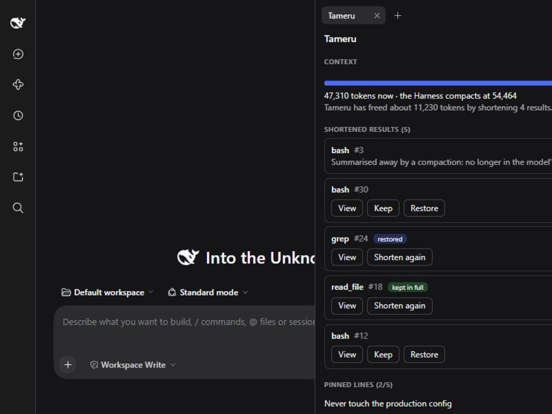
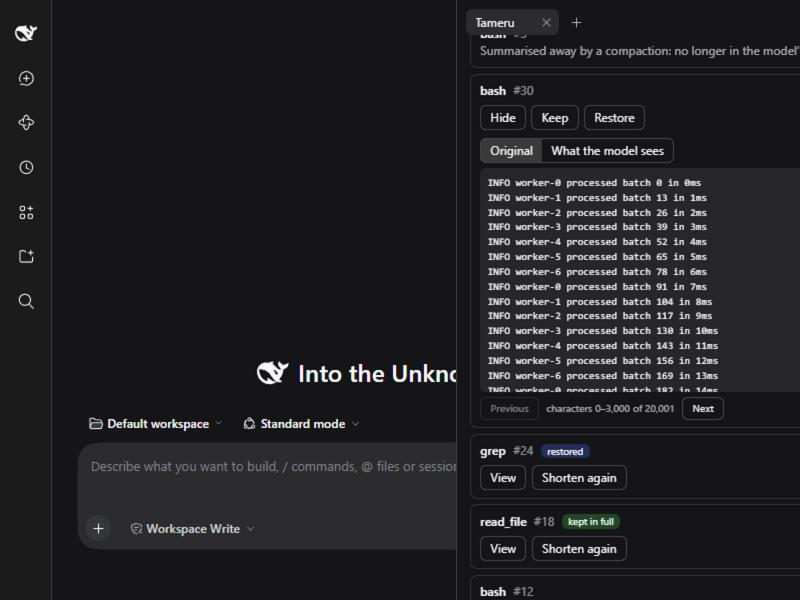
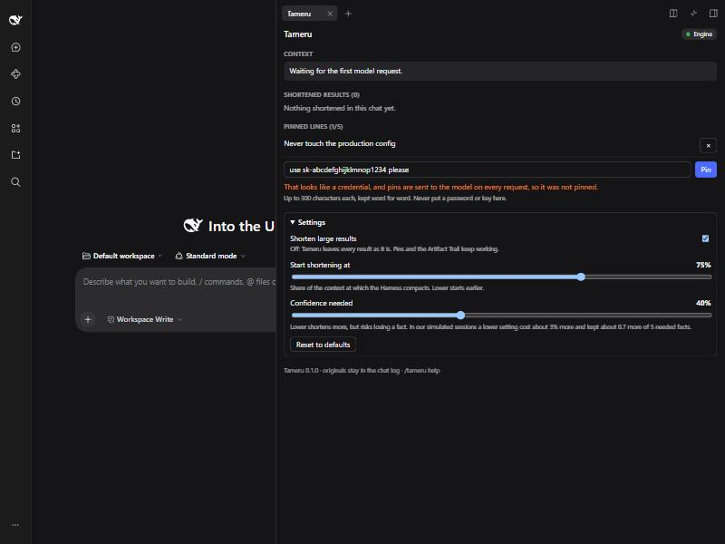

# dsh-tameru

[Tameru](https://github.com/0xWhiteMage/tameru-compaction-system) for [DeepSeek Harness](https://github.com/deepseek-ai/deepseek-harness): shortens bulky tool output before it fills the context, keeps every error, and lets you pin, keep and restore. Local, deterministic, no extra model calls.

> **Status: early development (0.1.0, unreleased).** Every feature below is built and tested against the real Harness packages, and the interface was exercised in the real Harness web client (also beside DS Bot), but **no real model has run through it yet** and nothing is published. Read the two measurements before relying on it: [per output](docs/MEASURED-VS-STOCK.md) (Tameru keeps far more needed facts than the stock pruner, removes less) and [whole simulated sessions](docs/REPLAY-VS-STOCK.md) (**no cost saving: cost-neutral at the shipped settings, about 3% dearer when the confidence gate is lowered**).

## What works today

- **Shortening.** At each step boundary, once the context passes 75% of the point where the Harness itself would start compacting, large old tool results (6,000+ characters, not errors, not the newest four, not anything the model has not read yet) are replaced by the engine's query-aware extract, and only when the engine is at least 70% confident and the change frees at least 35% of the tokens it makes the provider rewrite. The original stays in the session log; the replacement is the same pair of events the Harness's own pruner writes, so the Harness's token meter stays exact.
- **A way back.** Every shortened result names its original (`reference N`). The model reads it back with the `tameru_read_original` tool, in windows of up to 20,000 characters, and only for results Tameru shortened in its own chat. You can read one with `/tameru view N`.
- **Keep and Restore.** `/tameru keep N` shows the model the full original until you `/tameru unkeep N`; `/tameru restore N` shows it in full for the model's next 3 replies, after which Tameru may shorten it again. Nothing is stored outside the chat: a result's state is in the chat log itself, so it survives a restart and a fork. If the agent is working when you ask, the change is queued and made before its next step.
- **Pins.** `/tameru pin TEXT` keeps a line of yours (up to 5, 300 characters each) in front of the model on every request, word for word. Pins are a section of the system prompt, which no compaction replaces, so they survive every summary. They are only ever text you typed: no tool lets the model pin, and text that looks like a credential is refused (a heuristic, not a guarantee). `{{curly braces}}` in a pin are kept literally. Pins are saved in `<Harness home>/tameru/pins.json`, which `/tameru purge` empties; removing the plugin leaves that folder.
- **Artifact Trail.** After the Harness compacts a chat, one short note is added listing the files touched, the commands run (and which failed) and the distinct errors in what the summary replaced, so the agent knows what it already did. It is built only from tool-call names, path and command arguments and error flags, each line capped and stripped of markup, never from the body of any output, and it says it is data. It carries forward through later compactions.
- **The Tameru tab.** In the right sidebar's new-tab guide, **Tameru** opens a panel for the chat it sits in: a context gauge against the point where the Harness compacts (with where Tameru starts), the list of results Tameru shortened with their sizes, a viewer for each (the original, or what the model sees, in pages), Keep, Restore and Shorten again buttons, your pinned lines, and a settings drawer (shorten on or off, where to start, how confident the engine must be) with its measured trade-off written next to it. Changes made while the agent is working are queued and shown as such. English and Chinese, light and dark. Settings you change are saved in `<Harness home>/tameru/settings.json` and apply at once.
- It stands down for any chat whose compaction another plugin (for example DS Bot) manages, while a compaction is running, and whenever the model declares no usable context window.
- `/tameru` shows the plugin version, the engine version, whether the engine is running, and what was shortened in this chat.
- The Tameru engine runs as an isolated Python worker on the interpreter the Harness bundles (or one you name), started through the Harness's own managed subprocess service.
- It fails open: if Python is missing, or the engine is slow, crashes or misbehaves, nothing in your chat changes, and after repeated failures the engine turns itself off until restart.
- With `enabled: false` the plugin adds nothing at all.

## What is left

Verification with a real model that declares a context window, and publishing, which is the author's call. [docs/COMPATIBILITY.md](docs/COMPATIBILITY.md) lists exactly what has and has not been verified; [docs/RELEASING.md](docs/RELEASING.md) is the checklist.

## Install

Not published yet. For development, see [Development](#development). Requires DeepSeek Harness **0.2.2-rc.1** (the version this plugin is tested on; the Harness refuses to enable it on other versions) and Python 3.10+ (bundled with the Harness).

## What it looks like

The Tameru tab, in the sidebar's new-tab guide, in the Harness's own dark theme (the Harness follows light and dark; the panel inherits its colours).







*The first two images show sample data fed to the page: the stub model used for these screenshots cannot run tools, so there was nothing real to shorten. The third is the real panel against the real server.*

## Settings

| Setting | Default | Meaning |
|---|---|---|
| `enabled` | `true` | `false` makes the plugin do nothing. |
| `pythonPath` | the Harness's bundled Python | A Python 3.10+ interpreter for the engine. On Windows there is no fallback to a bare `python`. |
| `shorten` | `true` | `false` stops shortening but keeps `/tameru`. |
| `activation` | `0.75` | Start acting at this fraction (0.3 to 0.95) of the Harness's own compaction trigger. |
| `minConfidence` | `0.7` | The engine must be at least this confident in an extract, or the result is left alone. |
| `share` | `0.35` | A change must free at least this share of the tokens it makes the provider rewrite. |
| `protectRecent` | `4` | The newest read tool results always left as they are. |
| `minResultChars` | `6000` | Results shorter than this are never touched. |
| `maxPerPass` | `24` | Most results shortened at one step boundary. |

## How it stays out of the way

- It adds one row to the Harness composition and **disables, replaces or wraps nothing** of the Harness or of other plugins (see `cordis.patch.yml`). Turning the bundle Off or removing it leaves the Harness stock.
- Everything it adds is named `tameru`: the command `/tameru`, the plugin `dsh-tameru`, the row `tameru`.
- The engine worker accepts a fixed short list of fields. It cannot be asked to write to disk, reach a network or run a model, and a test proves it writes nothing under the home directory.
- The worker starts isolated (`python -I -B -P`), so a file planted in a workspace cannot be imported, and it exits when the Harness closes its input.

## Development

```bash
npm install
npm test                 # protocol, fail-open client, shortening against real Harness sessions, event-bus integration, lane checks
node scripts/compare_stock.ts            # the stock-pruner comparison (add --heldout for the second set)
npm run build            # bundles src/host to lib/host.js
python scripts/check_vendored.py --engine <path to tameru-compaction-system>
```

How it fits the Harness: [docs/ARCHITECTURE.md](docs/ARCHITECTURE.md). What has and has not been verified: [docs/COMPATIBILITY.md](docs/COMPATIBILITY.md). Release checklist: [docs/RELEASING.md](docs/RELEASING.md). `scripts/dev_harness.py up [--with-ds-bot]` serves the installed Harness against a throwaway home with this plugin installed, for trying the interface.

`vendor/tameru/` is the engine, byte for byte; `VENDORED_FROM` in its `__init__.py` names the commit and `check_vendored.py` proves the copy is identical. The engine is [harness-agnostic](https://github.com/0xWhiteMage/tameru-compaction-system/blob/main/docs/REPOSITORIES.md); this repository owns only what is specific to DeepSeek Harness.

## Licence

Apache-2.0. See `LICENSE`, `NOTICE` and `THIRD_PARTY_NOTICES.md`.
