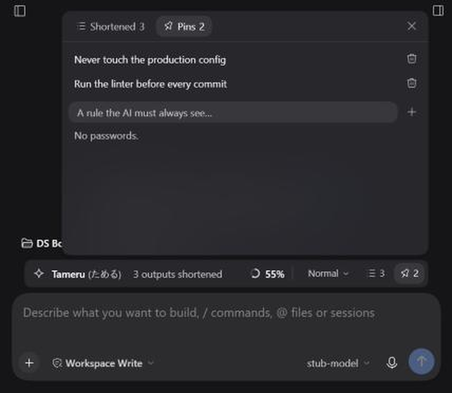
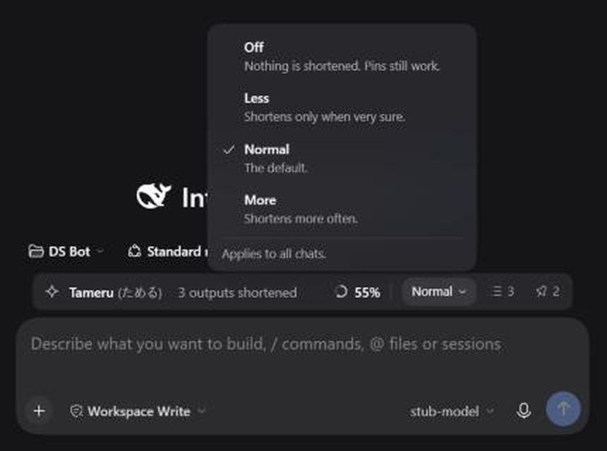

# dsh-tameru

[Tameru](https://github.com/0xWhiteMage/tameru-compaction-system) for [DeepSeek Harness](https://github.com/deepseek-ai/deepseek-harness): shortens bulky tool output before it fills the context, keeps every error, and lets you pin, keep and restore. Local, deterministic, no extra model calls.

> **Status: early development (0.2.0, unreleased, Beta; engine 1.10.0). The default is the incumbent behaviour (stable channel: every-step, gate 0.7); the round 1 candidate (`at-trigger`, no gate) is beta-only because its holdout look failed gate 8.** Every feature below is built and tested against the real Harness packages, and the interface was exercised in the real Harness web client (also beside DS Bot), but **no real model has run through it yet** and nothing is published. Read the two measurements before relying on it (**both were run on engine 1.9.0 and have not been redone for engine 1.10.0**; the engine's own replay numbers for 1.10.0 are in the [CHANGELOG](CHANGELOG.md), replay-only, and say nothing about cost): [per output](docs/MEASURED-VS-STOCK.md) (Tameru keeps far more needed facts than the stock pruner, removes less) and [whole simulated sessions](docs/REPLAY-VS-STOCK.md) (**no cost saving: cost-neutral at the shipped settings, about 3% dearer when the confidence gate is lowered**).

## What works today

- **Shortening.** At each step boundary, once the context passes 75% of the point where the Harness itself would start compacting, large old tool results (6,000+ characters, not errors, not the newest four, not anything the model has not read yet) are replaced by the engine's query-aware extract, and only when the engine itself accepts the extract (its `decide()` rule: not declined, not sanitized, shorter, confidence at least the strength setting, 70% at Normal) and the change frees at least 35% of the tokens it makes the provider rewrite. Credential-shaped text in an extract is replaced by `[tameru:redacted]`; when the engine declines it hands back the original unredacted, which is never used. The original stays in the session log; the replacement is the same pair of events the Harness's own pruner writes, so the Harness's token meter stays exact.
- **A way back.** Every shortened result names its original (`ref=N`) and what was left out (`dropped: 399 log lines (step)`). The model reads it back with the `tameru_read_original` tool, in windows of up to 20,000 characters or, with `grep`, as the matching lines with their line numbers, and only for results Tameru shortened in its own chat. You can read one with `/tameru view N`.
- **Keep and Restore.** `/tameru keep N` shows the model the full original until you `/tameru unkeep N`; `/tameru restore N` shows it in full for the model's next 3 replies, after which Tameru may shorten it again. Nothing is stored outside the chat: a result's state is in the chat log itself, so it survives a restart and a fork. If the agent is working when you ask, the change is queued and made before its next step.
- **Pins.** `/tameru pin TEXT` keeps a line of yours (up to 5, 300 characters each and 1,500 together) in front of the model on every request, word for word. Pins are a section of the system prompt, which no compaction replaces, so they survive every summary. They are only ever text you typed: no tool lets the model pin, and text that looks like a credential is refused (a heuristic, not a guarantee). `{{curly braces}}` in a pin are kept literally. Pins are saved in `<Harness home>/tameru/pins.json`, which `/tameru purge` empties; removing the plugin leaves that folder.
- **Artifact Trail.** After the Harness compacts a chat, one short note is added listing the files touched, the commands run (and which failed) and the distinct errors in what the summary replaced, so the agent knows what it already did. It is built only from tool-call names, path and command arguments and error flags, each line capped and stripped of markup, never from the body of any output, and it says it is data. It carries forward through later compactions.
- **One bar.** Above the message box, **Tameru (ためる)** is one solid line, drawn the way the Harness's own goal bar is, so it lines up with the message box and nothing shows through it. Left to right: a small Tameru star whose colour is its state, the name, one status phrase (`3 outputs shortened`, `Idle until 59% full`, `Off`, `Not running`), a context ring with `55% full`, then three controls: the **strength** menu (**Off · Less · Normal · More**), a **results** button with the count of shortened outputs, and a **pins** button with the pin count. There is no pause button (Off is pause) and no chevron. It is the same bar, with the same icons and words, as the [Hermes plugin](https://github.com/0xWhiteMage/hermes-tameru-plugin): the rules are in the engine repository's [plugin interface spec](https://github.com/0xWhiteMage/tameru-compaction-system/blob/main/docs/PLUGIN-UI.md).
- **The card.** The results or pins button opens a card that floats above the bar, so the chat and the message box never move; it closes on Esc, a click elsewhere or the close icon. Its two tabs are **Shortened** and **Pins**. Each result says what was run (`bash  npm test -- checkout`), then `52K → 2K` characters, then one **Keep** button (a lock): Keep shows the AI that output in full until you release it. Click the row to read it in the card, **AI sees** or **Original**. Outputs you keep sit below a `Kept in full` divider. Pins are lines the AI always sees; removing one offers Undo for five seconds. A problem shows a short phrase on the bar and says in the card what happened, that your chat is unchanged, and what to do.
- English and Chinese, light and dark, keyboard operable (arrow keys in the menu and between tabs, Tab hands over into the card and back, Esc closes). The strength is saved in `<Harness home>/tameru/settings.json` (only what you changed) and applies at once, to every chat.
- It stands down for any chat whose compaction another plugin (for example DS Bot) manages, while a compaction is running, and whenever the model declares no usable context window.
- `/tameru` shows the plugin version, the engine version, whether the engine is running, and what was shortened in this chat.
- The Tameru engine runs as an isolated Python worker on the interpreter the Harness bundles (or one you name), started through the Harness's own managed subprocess service.
- It fails open: if Python is missing, or the engine is slow, crashes or misbehaves, nothing in your chat changes, and after repeated failures the engine rests for five minutes and is then tried again; meanwhile nothing is shortened and your chat is unchanged.
- With `enabled: false` the host half does nothing: no command, listener, tool, pins or route. The browser bundle still loads, and its bar then shows that it cannot reach the plugin.

## What is left

Verification with a real model that declares a context window, and publishing, which is the author's call. [docs/COMPATIBILITY.md](docs/COMPATIBILITY.md) lists exactly what has and has not been verified; [docs/RELEASING.md](docs/RELEASING.md) is the checklist.

## Install

Not published yet. For development, see [Development](#development). Requires DeepSeek Harness **0.2.2-rc.5** (the version this plugin is tested on; the Harness refuses to enable it on other versions) and Python 3.10+ (bundled with the Harness).

## What it looks like

In the Harness's own dark theme. The bar closed; the card on results; a result opened in the card; the pins; the strength menu.






*These images show sample data fed to the page: the stub model used for the screenshots cannot run tools, so there was nothing real to shorten. The bar itself is the real client in the real Harness.*

## Settings

Two channels. **`stable` (the default) runs the incumbent behaviour**, the one with a track record (0.1.2 on engine 1.9.0): `every-step`, confidence gate 0.7 (Normal), activation 0.75, share 0.35, the newest 4 results protected, 6,000 characters minimum, 24 per pass. On stable a stored `policy` is ignored. **`beta`** honours `policy`; with no `policy` set it runs the round 1 candidate, `at-trigger` with no confidence gate, which is **unconfirmed: its one holdout look failed gate 8** (see the [CHANGELOG](CHANGELOG.md)). A stored `minConfidence` or `policy` is used exactly as stored on beta. The bar shows a **Beta** badge on beta, and the card's last line names the channel, policy and gate in force (the host resolves them once; the bar shows nothing it did not get from the host). A gate that is none of Less (0.85), Normal (0.7) or More (0.55), or any policy other than `every-step`, shows as **Custom** and is kept as set.

This table is generated from `src/shared/settings-table.ts` (a test fails if it drifts):

| Setting | Default | Range | Channel | Meaning |
|---|---|---|---|---|
| `enabled` | `true` | boolean | both, profile only | `false` turns the host half off (the bar still loads but cannot reach it). |
| `pythonPath` | the Harness's bundled Python | string | both, profile only | A Python 3.10+ interpreter for the engine. On Windows there is no fallback to a bare `python`. |
| `shorten` | `true` | boolean | both | `false` stops shortening but keeps `/tameru` (the strength menu's Off). |
| `channel` | `stable` | `stable`, `beta` | both | `stable` always runs the incumbent behaviour (`every-step`, whatever `policy` says). `beta` honours `policy`; with no `policy` set it runs the unconfirmed round 1 candidate, `at-trigger` with no confidence gate (its holdout look failed gate 8). |
| `policy` | `every-step` (`at-trigger` on beta when unset) | `every-step`, `at-trigger`, `hybrid`, `plan` | beta | When to act (beta channel only). `every-step`: at every step boundary past `activation`, old results only, with the confidence gate. `at-trigger`: only where the Harness's own pruner is about to cut, the extract in place of its head/tail cut. `hybrid`: at the trigger, ordinary candidates, share rule beyond the stock cut. `plan`: at the trigger, the engine's `plan()` covers every result stock would cut — an extract when the EV rule accepts it, the stock cut otherwise. Measured in [docs/REPLAY-PLAN-P3.md](docs/REPLAY-PLAN-P3.md), replay only. |
| `priceProfile` | `deepseek-v4-pro` | `deepseek-flash`, `deepseek-v4-pro` | beta | The engine price profile `plan`'s EV rule prices rewrites with. The strength picks the EV strength instead of a confidence gate: Less `less`, Normal `normal`, More `more`. |
| `activation` | `0.75` | 0.3 to 0.95 | both | Start acting at this fraction of the Harness's own compaction trigger (`every-step` only; the trigger policies act at 1.0). |
| `minConfidence` | `0.7` (`0` for `at-trigger` on beta when unset) | 0 to 1 | both | The engine must be at least this confident in an extract, or the result is left alone. Less, Normal and More set 0.85, 0.7 and 0.55; any other stored value shows as Custom and is kept as a hard minimum. |
| `share` | `0.35` | 0.1 to 0.9 | both | A change must free at least this share of the tokens it makes the provider rewrite. |
| `protectRecent` | `4` | 0 to 100 (whole) | both | The newest read tool results always left as they are. |
| `minResultChars` | `6000` | 1000 to 1000000 (whole) | both | Results shorter than this are never touched. |
| `maxPerPass` | `24` | 1 to 100 (whole) | both | Most results shortened at one step boundary. |
| `lambdaMultiplier` | `1` | 0.001 to 1000 | beta | **Reserved.** For the expected-value rule (risk appetite): accepted and stored, not used yet. |

## How it stays out of the way

- It adds one row to the Harness composition and **disables, replaces or wraps nothing** of the Harness or of other plugins (see `cordis.patch.yml`). Turning the bundle Off or removing it leaves the Harness stock.
- Everything it adds is named `tameru`: the command `/tameru`, the plugin `dsh-tameru`, the row `tameru`.
- The engine worker accepts a fixed short list of fields. It cannot be asked to write to disk, reach a network or run a model, and a test proves it writes nothing under the home directory.
- The worker starts isolated (`python -I -B -P`), so a file planted in a workspace cannot be imported, and it exits when the Harness closes its input.

## Development

```bash
npm install
npm test                 # protocol, fail-open client, shortening against real Harness sessions, event-bus integration, lane checks
node scripts/compare_stock.ts            # the stock-pruner comparison (add --heldout for the second set)
npm run build            # bundles src/host to lib/host.js
python scripts/check_vendored.py --engine <path to tameru-compaction-system>
```

How it fits the Harness: [docs/ARCHITECTURE.md](docs/ARCHITECTURE.md). What has and has not been verified: [docs/COMPATIBILITY.md](docs/COMPATIBILITY.md). Release checklist: [docs/RELEASING.md](docs/RELEASING.md). `scripts/dev_harness.py up [--with-ds-bot]` serves the installed Harness against a throwaway home with this plugin installed, for trying the interface.

`vendor/tameru/` is the engine, byte for byte; `VENDORED_FROM` in its `__init__.py` names the commit and `check_vendored.py` proves the copy is identical. The engine is [harness-agnostic](https://github.com/0xWhiteMage/tameru-compaction-system/blob/main/docs/REPOSITORIES.md); this repository owns only what is specific to DeepSeek Harness.

## Licence

Apache-2.0. See `LICENSE`, `NOTICE` and `THIRD_PARTY_NOTICES.md`.
