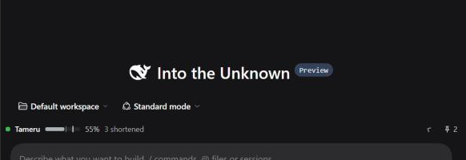

# dsh-tameru

[Tameru](https://github.com/0xWhiteMage/tameru-compaction-system) for [DeepSeek Harness](https://github.com/deepseek-ai/deepseek-harness): shortens bulky tool output before it fills the context, keeps every error, and lets you pin, keep and restore. Local, deterministic, no extra model calls.

> **Status: v0.2.0, Beta — engine 1.10.0 vendored (`d37fd43`).** The default is the incumbent behaviour (stable channel: `every-step`, gate 0.7, activation 0.75); the `at-trigger` candidate stays beta-only because its holdout look failed gate 8. Built and tested against the real Harness packages and exercised in the real web client, but **no real model has run through it yet**. The plugin's own measurements were run on engine 1.9.0 and not redone for 1.10.0 — read them before relying on it: [per output](docs/MEASURED-VS-STOCK.md) · [whole sessions](docs/REPLAY-VS-STOCK.md) (**cost-neutral at shipped settings**). Engine-1.10.0 replay numbers: [CHANGELOG.md](CHANGELOG.md).

[Install](#install) · [Features](#features) · [Settings](#settings) · [Docs](#documentation)

## Install

Requires DeepSeek Harness **0.2.2-rc.5** (the version it is tested on; the Harness refuses other versions) and Python 3.10+ (bundled with the Harness).

```bash
npm install -g dsh-tameru     # then enable it in the Harness's plugin settings
```

Removing it leaves `<Harness home>/tameru/` (pins and settings) — `/tameru purge` empties it. The Harness sends the names of active plugins with requests to the official DeepSeek API.

## Features

- **Shortening** — at each step boundary past 75% of the point where the Harness itself would compact, large old tool results are replaced by the engine's query-aware extract, only when the engine accepts it and the change frees at least 35% of the tokens it makes the provider rewrite. Credential-shaped text is never applied.
- **A way back** — every shortened result names its original (`ref=N`); the model reads it back with the `tameru_read_original` tool, and you with `/tameru view N`.
- **Keep and Restore** — `/tameru keep N` shows the model the full original until `/tameru unkeep N`; `/tameru restore N` shows it for the next 3 replies.
- **Pins** — `/tameru pin TEXT` keeps a line of yours (up to 5) word for word in front of the model on every request — a system-prompt section no compaction replaces.
- **Artifact Trail** — after a compaction, one short note lists files touched, commands run (and which failed) and distinct errors, so the agent knows what it already did.
- **One bar** — the shared Tameru bar (same icons and words as the [Hermes plugin](https://github.com/0xWhiteMage/hermes-tameru-plugin)): state star, status phrase, context ring, strength menu, results and pins. A card floats above it; English and Chinese, light and dark, keyboard operable.
- **Fail-open** — the engine runs as an isolated worker (`python -I -B -P`) on the Harness's bundled Python; if Python is missing or the engine is slow or crashes, nothing in the chat changes.
- `enabled: false` turns the host half off entirely. `/tameru` shows versions, engine state and this chat's cleanups.



*The bar and card in the Harness's own dark theme; more in [docs/](docs/) — the images show sample data because the screenshot model cannot run tools.*

## Settings

Two channels. **`stable` (the default) runs the incumbent behaviour**: `every-step`, confidence gate 0.7 (Normal), activation 0.75, share 0.35, newest 4 protected, 6,000-char minimum, 24 per pass. **`beta`** honours `policy`; unset, it runs the unconfirmed `at-trigger` candidate. The bar shows a **Beta** badge on beta, and the card's last line names the channel, policy and gate in force.

This table is generated from `src/shared/settings-table.ts` (a test fails if it drifts):

| Setting | Default | Range | Channel | Meaning |
|---|---|---|---|---|
| `enabled` | `true` | boolean | both, profile only | `false` turns the host half off (the bar still loads but cannot reach it). |
| `pythonPath` | the Harness's bundled Python | string | both, profile only | A Python 3.10+ interpreter for the engine. On Windows there is no fallback to a bare `python`. |
| `shorten` | `true` | boolean | both | `false` stops shortening but keeps `/tameru` (the strength menu's Off). |
| `channel` | `stable` | `stable`, `beta` | both | `stable` always runs the incumbent behaviour (`every-step`, whatever `policy` says). `beta` honours `policy`; with no `policy` set it runs the unconfirmed round 1 candidate, `at-trigger` with no confidence gate (its holdout look failed gate 8). |
| `policy` | `every-step` (`at-trigger` on beta when unset) | `every-step`, `at-trigger`, `hybrid`, `plan` | beta | When to act (beta channel only). `every-step`: at every step boundary past `activation`, old results only, with the confidence gate. `at-trigger`: only where the Harness's own pruner is about to cut, the extract in place of its head/tail cut. `hybrid`: at the trigger, ordinary candidates, share rule beyond the stock cut. `plan`: at the trigger, the engine's `plan()` covers every result stock would cut — an extract when the EV rule accepts it, the stock cut otherwise. Measured in [docs/REPLAY-PLAN-P3.md](docs/REPLAY-PLAN-P3.md), replay only. |
| `priceProfile` | `deepseek-v4-pro` | `deepseek-flash`, `deepseek-v4-pro` | beta | The engine price profile `plan`'s EV rule prices rewrites with. The strength picks the EV strength instead of a confidence gate: Less `less`, Normal `normal`, More `more`. |
| `activation` | `0.75` | 0.3 to 0.95 | both | Start acting at this fraction of the Harness's own compaction trigger (`every-step` only; the trigger policies act at 1.0). |
| `minConfidence` | `0.7` (`0` for `at-trigger` on beta when unset) | 0 to 1 | both | The engine must be at least this confident in an extract, or the result is left alone. Less, Normal and More set 0.85, 0.7 and 0.55; any other stored value shows as Custom and is kept as a hard minimum. |
| `share` | `0.35` | 0.1 to 0.9 | both | A change must free at least this share of the tokens it makes the provider rewrite. |
| `protectRecent` | `4` | 0 to 100 (whole) | both | The newest read tool results always left as they are. |
| `minResultChars` | `6000` | 1000 to 1000000 (whole) | both | Results shorter than this are never touched. |
| `maxPerPass` | `24` | 1 to 100 (whole) | both | Most results shortened at one step boundary. |
| `lambdaMultiplier` | `1` | 0.001 to 1000 | beta | **Reserved.** For the expected-value rule (risk appetite): accepted and stored, not used yet. |

## How it stays out of the way

- One row in the Harness composition; **disables, replaces or wraps nothing** of the Harness or other plugins. Off or removed, the Harness is stock.
- Everything is named `tameru`: the command `/tameru`, the plugin `dsh-tameru`, the row `tameru`.
- The engine worker accepts a fixed short list of fields — it cannot be asked to write to disk, reach a network or run a model; a test proves it writes nothing under the home directory.

## Documentation

| I want to… | Go to |
|---|---|
| Per-output measurements vs stock | [docs/MEASURED-VS-STOCK.md](docs/MEASURED-VS-STOCK.md) |
| Whole-session replay vs stock | [docs/REPLAY-VS-STOCK.md](docs/REPLAY-VS-STOCK.md) |
| What is and isn't verified | [docs/COMPATIBILITY.md](docs/COMPATIBILITY.md) |
| How it fits the Harness | [docs/ARCHITECTURE.md](docs/ARCHITECTURE.md) |
| Version history + replay results | [CHANGELOG.md](CHANGELOG.md) |
| The engine itself | [tameru-compaction-system](https://github.com/0xWhiteMage/tameru-compaction-system) |
| The Hermes sibling | [hermes-tameru-plugin](https://github.com/0xWhiteMage/hermes-tameru-plugin) |

## Development

```bash
npm install
npm test                 # protocol, fail-open client, shortening against real Harness sessions
node scripts/compare_stock.ts
npm run build            # bundles src/host to lib/host.js
python scripts/check_vendored.py --engine <path to tameru-compaction-system>
```

`vendor/tameru/` is the engine byte for byte; `VENDORED_FROM` names the commit (`d37fd43`, engine v1.10.0) and `check_vendored.py` proves the copy is identical. Release checklist: [docs/RELEASING.md](docs/RELEASING.md).

## Licence

Apache-2.0. See `LICENSE`, `NOTICE` and `THIRD_PARTY_NOTICES.md`. Built by thewhitemage.
