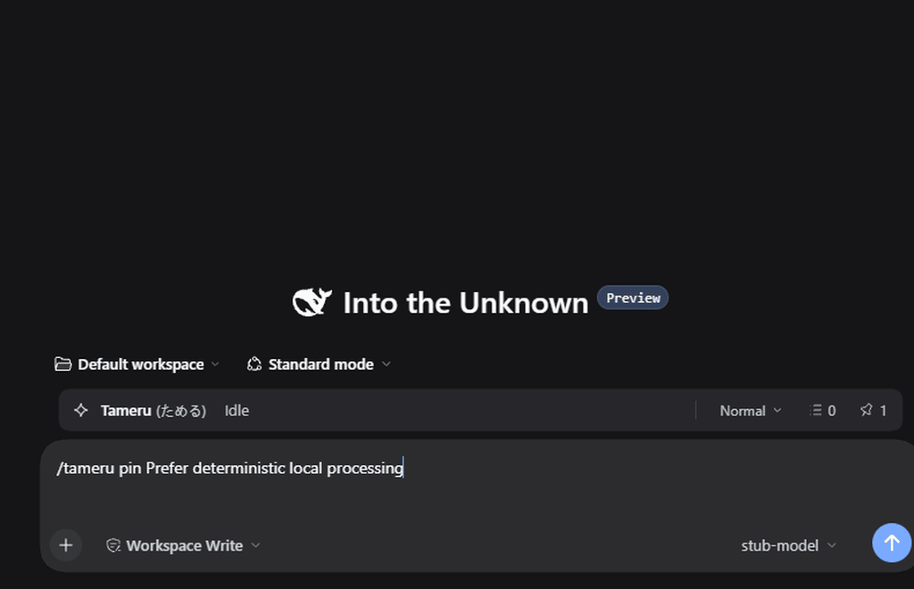

# dsh-tameru

[Tameru](https://github.com/0xWhiteMage/tameru-compaction-system) 的 [DeepSeek Harness](https://github.com/deepseek-ai/deepseek-harness) 插件：在庞大的工具输出占满上下文之前将其缩短，保留错误信息，并支持固定、保留和恢复。全程本地运行、结果确定、不额外调用模型。

> **状态：v0.1.0 Beta — 标签内置引擎 v1.10.0（`d37fd43`）；当前 `main` 跟踪后续 1.10.0 修复（`6ea331c`）。** GitHub Release 仍是草稿评估版本。默认使用稳定通道的既有策略（`every-step`、置信度 0.7、激活点 0.75）；`at-trigger` 因保留事实指标的守门检查未通过而只留在 Beta 通道。已用真实 Harness 包和真实网页客户端检查，但**尚未用真实模型验证**。完整说明、限制和测量口径见[英文 README](README.md)。

## 安装

需要 DeepSeek Harness **0.2.2-rc.5** 或 **0.2.3-alpha.2**（只接受这两个已测试版本）以及 Python 3.10+（通常使用 Harness 自带版本）：

```bash
npm install -g "github:0xWhiteMage/dsh-tameru-plugin#v0.1.0"     # 然后在 Harness 插件设置中启用
```



*这是在一次性 Harness 0.2.2-rc.5 网页客户端中的真实捕获，只操作本地固定和强度界面；没有运行模型或工具，因此缩短结果为 0。*

## 功能

- **缩短**：超过 Harness 自身压缩触发点 75% 后，只在引擎接受且重写值得时，用查询感知摘录替换较大的旧工具结果；形似凭据的内容不会被应用。
- **读回原文**：每条被缩短的结果都有 `ref=N`；模型可用 `tameru_read_original` 读回或用 `grep` 取匹配行，你可用 `/tameru view N` 查看。
- **保留与恢复**：`/tameru keep N` 让模型持续看到完整原文；`/tameru restore N` 让它在接下来的 3 次回复中看到完整原文。
- **固定**：`/tameru pin 文字` 将你写的话逐字放在系统提示中（最多 5 条）；形似凭据的内容会被拒绝。
- **Artifact Trail**：压缩后列出涉及文件、运行命令和不同错误，帮助代理避免重复工作。
- **统一栏**：与 Hermes 插件共享图标和用词，支持中英文、明暗主题和键盘操作。
- **失败时保持原状**：引擎在隔离的 Python worker 中运行；Python 缺失、引擎超时或崩溃时，聊天内容不变。

## 限制与测量

引擎 1.10.0 的数字是回放结果，不是真实模型、账单或回答质量测量。插件自身针对引擎 1.9.0 的测量没有按 1.10.0 重做；请阅读[每次输出测量](docs/MEASURED-VS-STOCK.md)、[整会话回放](docs/REPLAY-VS-STOCK.md)和[兼容性说明](docs/COMPATIBILITY.md)。不要把这些数字理解为降低成本或提升回答质量的承诺。

许可证：Apache-2.0。
